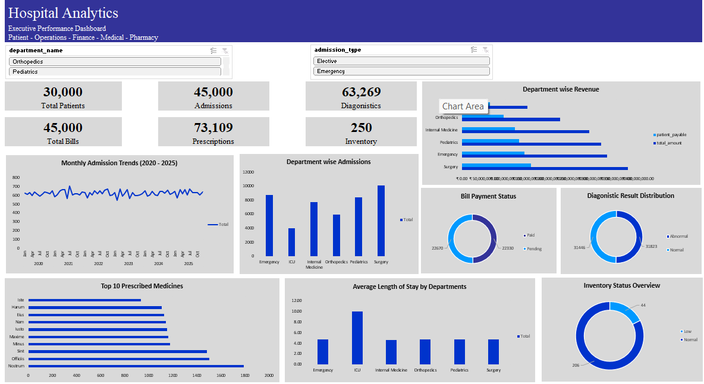

# 🏥 Hospital Analytics Dashboard

An end-to-end healthcare analytics project built using **MySQL and Microsoft Excel** to analyze patient demographics, hospital operations, financial performance, medical diagnostics, and pharmacy inventory.

## 📊 Dashboard Preview



## 1. Project Overview

Healthcare organizations generate large volumes of data across multiple departments. Extracting meaningful insights from this information is essential for improving operational efficiency, financial performance, and patient care.

This project transforms hospital data into actionable business insights through SQL-based data extraction, data preparation, Excel Data Model relationships, PivotTables, PivotCharts, and interactive dashboard reporting.

## 2. Business Objectives

- Analyze patient demographics and distribution.
- Monitor hospital admissions and department performance.
- Evaluate revenue, billing, and payment patterns.
- Understand diagnostic workload and test outcomes.
- Analyze prescription trends and pharmacy inventory.
- Support data-driven decision-making for hospital management.

## 3. Tools and Technologies

| Technology | Purpose |
|---|---|
| MySQL | Data extraction, joins, aggregations, and data preparation |
| Microsoft Excel | Data analysis and dashboard development |
| Power Query | Data transformation and cleaning |
| Excel Data Model | Data modeling and table relationships |
| PivotTables | Business analysis and KPI calculations |
| PivotCharts | Interactive data visualization |
| Slicers | Dynamic dashboard filtering |

## 4. Dataset Overview

The project uses a synthetic hospital dataset containing 19 original CSV files.

Six consolidated analytical datasets were prepared using SQL.

| Analytical Dataset | Records |
|---|---:|
| Patient Demographics | 30,000 |
| Admission Performance | 45,000 |
| Billing Financial | 45,000 |
| Medical Diagnostics | 63,269 |
| Pharmacy Prescriptions | 73,109 |
| Pharmacy Inventory | 250 |
| **Total** | **256,628** |

## 5. Dashboard KPIs

The executive dashboard provides an overview of hospital performance through six key indicators.

| KPI | Value |
|---|---:|
| Total Patients | 30,000 |
| Total Admissions | 45,000 |
| Diagnostic Records | 63,269 |
| Total Bills | 45,000 |
| Total Prescriptions | 73,109 |
| Inventory Medicines | 250 |

## 6. Analytical Modules

### A. Patient Analytics
- Patient distribution by gender.
- Patient distribution by age group.
- Patient distribution by city.
- Admissions by gender.

### B. Hospital Operations Analytics
- Monthly admission trends.
- Admissions by department.
- Admissions by disease.
- Average length of stay by department.
- Emergency vs. elective admissions.

### C. Financial Analytics
- Overall financial performance.
- Revenue by department.
- Insurance vs. patient payment contribution.
- Bill payment status.
- Revenue by payment mode.

### D. Medical Diagnostics Analytics
- Diagnostic tests by category.
- Most frequently conducted tests.
- Diagnostic result distribution.
- Doctor-wise diagnostic workload.
- Disease-wise diagnostic activity.

### E. Pharmacy and Inventory Analytics
- Most prescribed medicines.
- Prescription distribution by drug category.
- Manufacturer-wise prescription volume.
- Inventory status distribution.
- Medicines requiring reorder.
- Inventory value by drug category.

## 7. Data Modeling and Relationships

Six analytical datasets were loaded into the Excel Data Model.

Relationships were established using common identifiers such as:

- `patient_id`
- `admission_id`
- `drug_id`

Power Query was used to transform data types and prepare the datasets for analysis.

This approach enabled analysis across multiple related hospital datasets without manually combining all records into a single table.

## 8. Interactive Executive Dashboard

The executive dashboard brings together important operational, financial, medical, and pharmacy metrics.

It includes:

- KPI cards for high-level performance monitoring.
- Monthly admission trend visualization.
- Department-wise admission and revenue analysis.
- Paid vs. pending billing distribution.
- Diagnostic result distribution.
- Top prescribed medicines.
- Inventory status distribution.
- Average length of stay by department.
- Interactive slicers for exploring hospital data.

## 9. Business Value

The analysis provides hospital management with insights to:

- Monitor patient volume and admission patterns.
- Identify departments with higher operational workloads.
- Understand revenue distribution and pending payments.
- Evaluate diagnostic activity and workload.
- Monitor medicine availability and identify potential replenishment requirements.

## 10. Repository Structure

```text
hospital-analytics-dashboard/
│
├── README.md
├── .gitignore
│
├── Excel/
│   ├── 01_Patient_Demographics.xlsx
│   ├── 02_Admission_Performance.xlsx
│   ├── 03_Billing_Financial.xlsx
│   ├── 04_Medical_Diagnostics.xlsx
│   ├── 05_Pharmacy_Prescriptions.xlsx
│   └── 06_Pharmacy_Inventory.xlsx
│   └── Hospital_analytics_master.xlsx
│
├── SQL/
│   ├── Admission and Department Performance.sql
│   ├── Financial and Insurance Analytics.sql
│   ├── Medical Operations & Doctor Performance.sql
│   ├── Patient_analysis.sql
│   └── Pharmacy & Inventory Analytics.sql
│
├── SQL_Exports/
│   ├── 01_Patient_Demographics.sql
│   ├── 02_Admission_Performance.sql
│   ├── 03_Billing_Financial.sql
│   ├── 04_Medical_Diagnostics.sql
│   ├── 05_Pharmacy_Prescriptions.sql
│   └── 06_Pharmacy_Inventory.sql
│
└── Screenshots/
    └── Executive_Dashboard.png
```

## 11. Project Outcome

Developed an integrated healthcare analytics solution covering **256,628 records across six analytical datasets**, with 25 business analyses and an interactive Excel executive dashboard.

The project demonstrates practical skills in SQL, data preparation, data modeling, business analytics, KPI development, and dashboard reporting.

---

**Author:** Cyril Anand

**GitHub:** [cyrildude77](https://github.com/cyrildude77)

**Project Repository:** [Hospital Analytics Dashboard](https://github.com/cyrildude77/hospital-analytics-dashboard)
